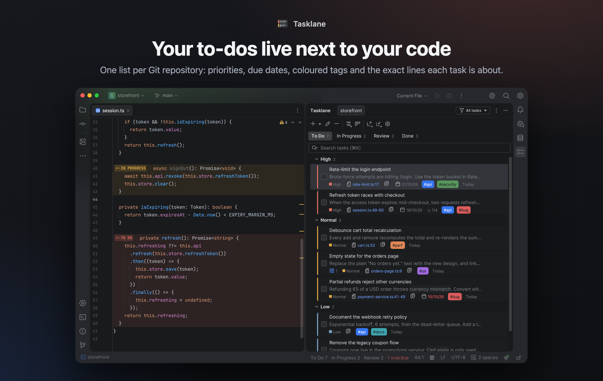
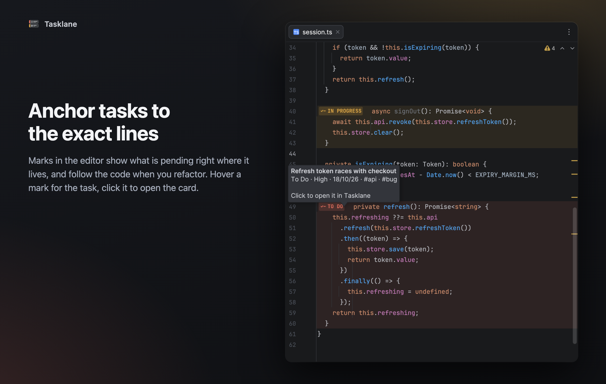
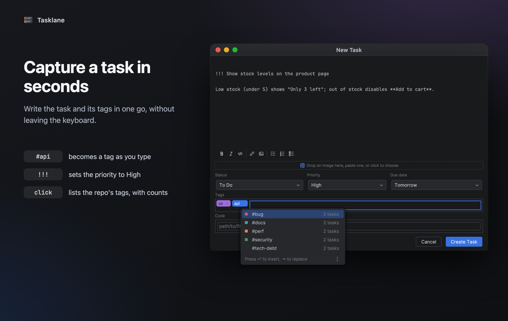
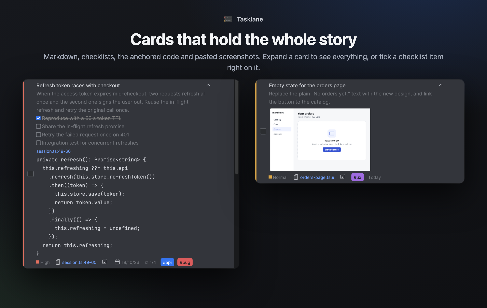
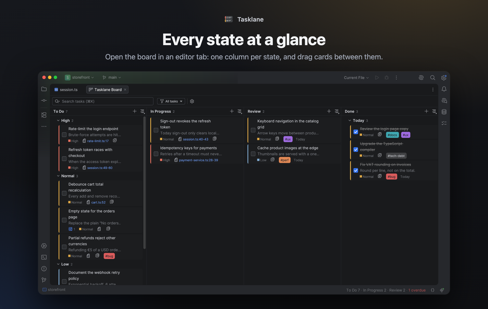
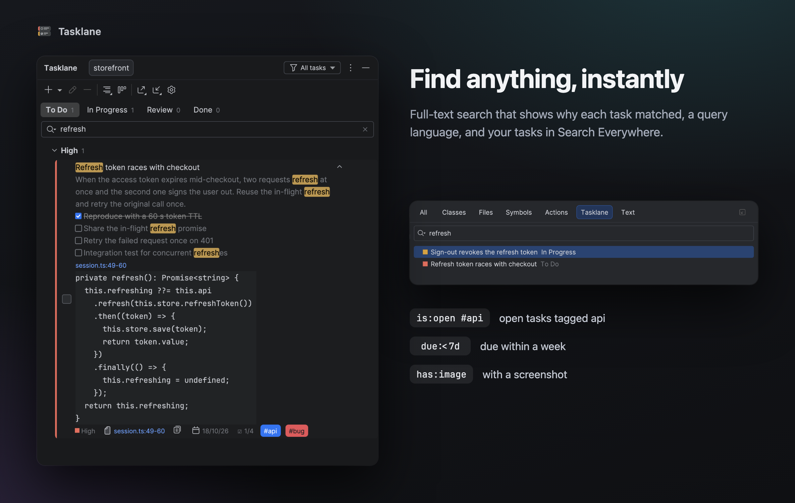
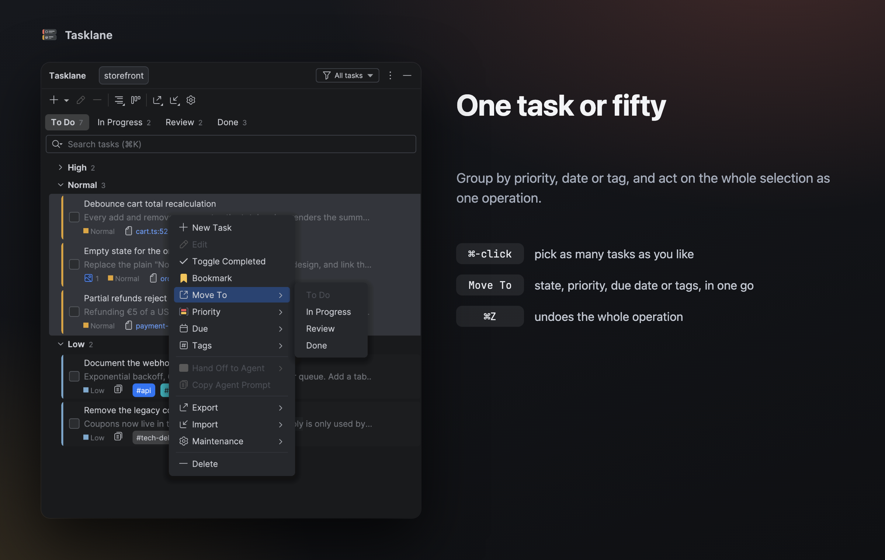
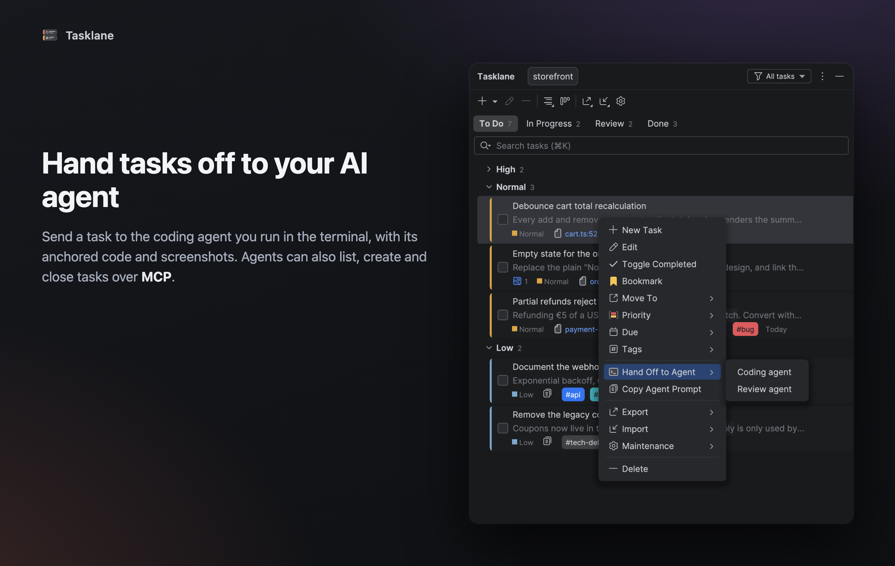
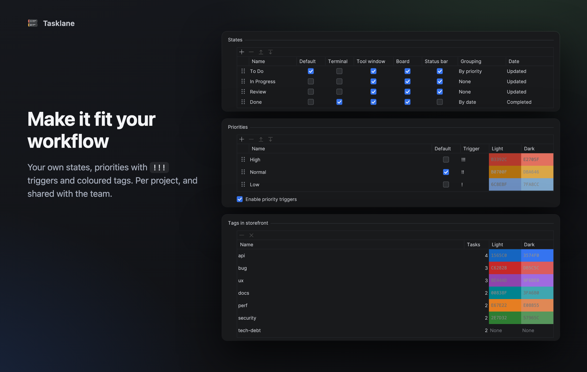
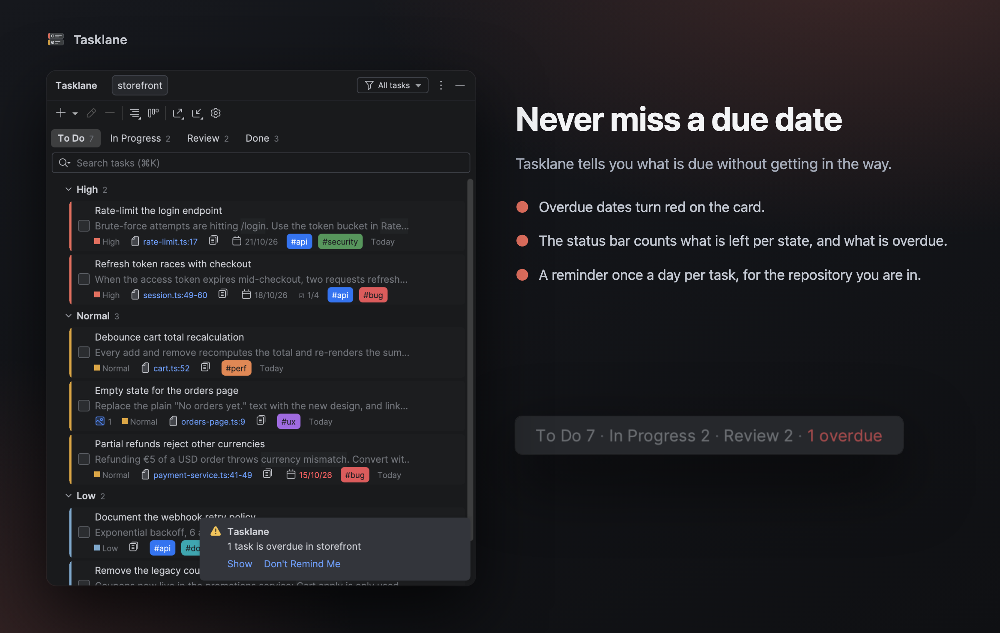

<div align="center">


# Tasklane

**Your to-dos live next to your code.**

A task list for JetBrains IDEs, one per Git repository, kept inside the project and able
to point at the exact lines each task is about. No account, no server, no network calls.

[](https://plugins.jetbrains.com/plugin/34247-tasklane)
[](https://plugins.jetbrains.com/plugin/34247-tasklane)
[](#install)
[](LICENSE)

[Install](#install) · [Feature tour](#feature-tour) · [Shortcuts](#keyboard-shortcuts) · [Full manual](docs/manual.md) · [Changelog](CHANGELOG.md)

</div>



## Why Tasklane

It's for the things you notice *while* you code: "this retry logic is broken", "add an
empty state here", "check this before I push". Too small for Jira or GitHub Issues. A
`// TODO` gets lost or ends up in a commit. A notes app has no idea which file you were in.

- **One list per Git repository**, stored in `.idea/tasklane/` with its own `.gitignore`:
  nothing shows up in `git status`.
- **Tasks point at code.** Anchor a task to a line or a block: the editor marks it, and the
  card takes you back to it.
- **Fully local.** A SQLite database inside the project, a daily backup and automatic
  repair. Nothing leaves your machine.
- **Any JetBrains IDE**: IntelliJ IDEA, WebStorm, PyCharm, GoLand, PhpStorm, RubyMine,
  CLion, Rider… Git, Terminal and MCP support are optional extras.

## Feature tour

### Anchor tasks to the exact lines



- Select some code and use *New Tasklane Task from Here* (editor right-click or `⌘⌥⇧R`):
  the task points at `session.ts:49-60`. Or type `src/Login.kt:42-58` (or a GitHub
  `#L42-L58`) in the dialog, with path completion.
- The editor marks anchored lines in the priority colour, as a gutter icon or an inline
  `TODO` pill. Hover for the task and its screenshots, click to open it.
- **Anchors follow the code.** They're found again by their text, so new lines above or a
  re-indent don't break them, and renaming or moving the file from the IDE takes them along.
  A file that disappears shows up as a broken anchor, never as a silent dead link.
- `Alt+Enter` on a `// TODO` turns it into an anchored task. *Import TODO Comments…* brings
  in every one in the project without touching the code.

### Capture a task in seconds



- `⌘⌥R` opens the task dialog from anywhere in the IDE, with or without the tool window.
- Start with `!!!` and the task is created as *High* (`!!` Normal, `!` Low; configurable).
- Type `#api` and a space and it becomes a tag. Click the tags field to see the
  repository's tags with their counts, so `#api` and `#apis` don't both happen.
- In the list, `⌘V` turns copied text into one task per line, and a screenshot into a task
  with that image. Drop files from Finder or the project view. One `⌘Z` removes it all.

### Cards that hold the whole story



- A Markdown body with a formatting toolbar: bold, italics, `code`, strikethrough and
  fenced code blocks, rendered on the card.
- **Checklists.** `- [ ] item` is a real checkbox you tick from the list, and the card
  counts `☑ 2/5`.
- **Screenshots** pasted, dropped or picked, stored at full size and deduplicated, with
  thumbnails in the list. Enlarge one and **pin** it over the editor while you code.
- Expand a card (`⌘↵`) to read everything, including the anchored block's current code.
  Links open with a single click.

### Every state at a glance



- *Open Board* lays out every state as a column in an editor tab. Drag a card, or a whole
  selection, to another column to move it.
- Same cards, menus, shortcuts and undo as the tool window, and the search and filter are
  shared between the two.
- In the tool window, states are tabs with live counts. Group by priority, date or tag,
  order by hand, and hide what was completed long ago.

### Find anything, instantly



- Full-text search over the whole body, ignoring case and accents, ranked by relevance
  (SQLite FTS5). Matches are highlighted, and a collapsed card shows the line that matched.
- A small query language, with completion for operators and values: `state:` `p:` `repo:`
  `is:` `has:` `file:` `#tag`, dates (`due:<7d`, `closed:week`, `created:>2026-09-01`) and
  `-` to exclude anything.
- Tasks show up in Search Everywhere (`⇧⇧`), in their own *Tasklane* tab.

### One task or fifty



- Complete, bookmark, move, change the priority, due date or tags, or delete a whole
  selection as **one operation**. Past ten tasks it runs in the background, and cancelling
  rolls it all back.
- **Real undo and redo** (`⌘Z` / `⌘⇧Z`) for everything you do in the list. Deleting
  doesn't ask: it offers *Undo* instead.
- Keyboard all the way: `Space` completes, `1`–`9` sets the priority, `⇧⌥←/→` moves to the
  previous or next state.

### Hand tasks off to your AI agent



- Turn on the IDE's MCP server (*Settings → Tools → MCP Server*) and Claude Code, Junie,
  Cursor or any MCP client can list, search, read, create, update and complete tasks, and
  tick checklist items. There is deliberately no delete tool.
- Agents get anchors resolved to **today's** line and the file paths of the screenshots.
- *Hand Off to Agent* opens an IDE terminal tab with your agent already working on the
  task: Claude Code by default, or Codex, Gemini, or anything else you add in the settings.
  The agent closes the task when it's done.
- *Copy Agent Instructions* gives you a paragraph for `CLAUDE.md` or `AGENTS.md`, so
  leftovers land in Tasklane instead of in `// TODO`s.

### Make it fit your workflow



- Your own states and priorities: names, order, triggers, grouping, and colours for light
  and dark themes.
- Coloured tags show as filled pills. Rename, merge or delete a tag across the repository.
- All of it lives in `.idea/tasklane.xml`, so you can commit it and share it with your
  team. Personal preferences stay in `workspace.xml`, and a template seeds new projects.

### Never miss a due date



- Due dates from presets or a calendar. Overdue ones turn red.
- A status bar widget counts what's left per state and what's overdue. Click a count to
  jump there.
- A reminder for what's due today or overdue in the repository you're in, at most once a
  day for each task.

### And also

- **Export** a state, a date group (as a ready-to-paste daily report) or the selection to
  the clipboard as Markdown or plain text, or save to `.md`, `.csv` or `.txt`. A `.zip`
  archive keeps tasks and screenshots together and imports back, merging by id.
- **Several repositories** in one project, each with its own list, a selector, and search
  across all of them.
- **Data you can trust**: a daily backup, an integrity check after a crash, and automatic
  repair that keeps the damaged file instead of deleting it, tested by killing the process
  mid-write.
- **Built for huge lists**: a nightly benchmark runs on a million tasks, and anything that
  grows with the list runs off the UI thread.
- **Accessible**: the whole tool window works from the keyboard, its parts have
  screen-reader names, and every action can be rebound in the Keymap.

## Install

- **Marketplace:** *Settings → Plugins → Marketplace*, search for **Tasklane**, or open
  [its page](https://plugins.jetbrains.com/plugin/34247-tasklane).
- **From disk:** download the zip from [Releases](https://github.com/palmerovicdev/tasklane/releases),
  then *Settings → Plugins → ⚙ → Install Plugin from Disk…*

Needs any JetBrains IDE **2026.1.5 or newer**. Without Git, the project root acts as a
single repository.

## Quick start

1. Open the **Tasklane** tool window and click *New Task*. The first line is the title;
   everything else is Markdown.
2. In the editor, select some code and press `⌘⌥⇧R` to anchor a task to it.
3. From anywhere, `⌘⌥R` captures a task without opening the tool window.
4. `⌘K` jumps to the search field. Try `is:open #api` or `due:<7d`.
5. Tick a card's checkbox, or press `Space`, to complete it. `⌘Z` undoes anything.

## Keyboard shortcuts

On Windows and Linux, `⌘` is `Ctrl` and `⌥` is `Alt`. Every action is listed in
*Settings → Keymap*, so any of these can be changed.

| Shortcut | Action | Where |
|---|---|---|
| `⌘⌥R` | New task | Anywhere |
| `⌘⌥⇧R` | New task anchored to the caret or selection | Anywhere |
| `⇧⇧` | Search tasks in Search Everywhere | Anywhere |
| `⌘K` | Focus the search field | Tool window |
| `⌘N` | New task in the current state | Task list |
| `Enter` | Edit the task | Task list |
| `Space` | Complete / reopen | Task list |
| `1` … `9` | Set the priority | Task list |
| `⌘↵` | Expand / collapse the card | Task list |
| `⇧⌥←` / `⇧⌥→` | Move to the previous / next state | Task list |
| `⌘⇧↑` / `⌘⇧↓` | Move up / down (manual order) | Task list |
| `⌘Z` / `⌘⇧Z` | Undo / redo | Task list |
| `Delete` | Delete, with *Undo* | Task list |

The full list is in the [manual](docs/manual.md#atajos-por-defecto).

## Where your data lives

| Path | What | In version control |
|---|---|---|
| `.idea/tasklane.xml` | States, priorities and tag colours | **Yes**, to share with your team |
| `.idea/tasklane/` | Tasks (SQLite), the daily backup and screenshots | No, it ships its own `.gitignore` |
| `workspace.xml` | Your preferences: open tab, filter, reminders… | No |

## Building from source

```bash
./gradlew test          # unit tests, no IDE needed
./gradlew buildPlugin   # -> build/distributions/tasklane-<version>.zip
./gradlew runIde        # a sandbox IDE with the plugin
```

It compiles against the IDE that `localIdePath` in `gradle.properties` points to, so nothing
is downloaded; an empty `-PlocalIdePath=` downloads the minimum supported platform, as CI
does. Requirements, versioning rules and the release process are in
[`docs/development.md`](docs/development.md).

**Releasing:** bump `pluginVersion`, `changeNotes` and `CHANGELOG.md` in a pull request, add
the **`release`** label and merge it. The `vX.Y.Z` tag, the GitHub release with the zip and,
when the signing secrets are set, the Marketplace upload follow on their own.

## Documentation

The detailed docs are written in Spanish.

- [Manual](docs/manual.md): every feature in detail, and why it works the way it does
- [Development](docs/development.md): building, versioning and releasing
- [Architecture and decisions](docs/architecture.html)
- [Roadmap](docs/roadmap.md)
- [Changelog](CHANGELOG.md)

Bug reports and ideas are welcome in [Issues](https://github.com/palmerovicdev/tasklane/issues).

## License

[MIT](LICENSE) © Victor Palmero
